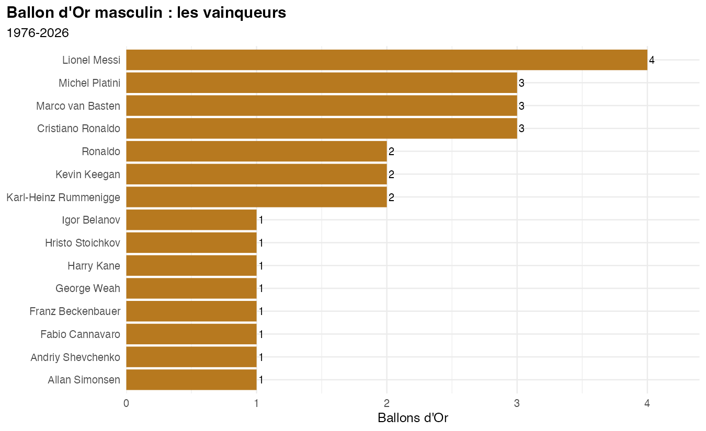

# Classements du Ballon d'Or, 1976-2026

Tous les classements publiés sur Wikipedia (anglais) depuis 1976 : Ballon d'Or masculin et féminin, FIFA Ballon d'Or,
trophées Kopa, Yachine et Gerd Müller, prix Puskás, joueuse FIFA de l'année. Une ligne par joueur classé, avec son
rang, son poste, sa nationalité, son club, ses points et les liens vers sa photo et son drapeau (1 919 lignes).



## Échantillon

`echantillon/ballon_dor_classements_2022_2026.csv` : les éditions 2022 à 2026 (431 lignes). Le jeu complet se refait
avec les scripts ci-dessous ; les pages téléchargées, les photos et les drapeaux ne sont pas publiés (licences
Wikimedia propres à chaque image : les liens `photo_url`, `flag_url` pointent vers l'original).

| Colonne | Contenu |
|---|---|
| `year`, `competition`, `sex` | édition, trophée, `Men` / `Women` |
| `rank` | rang dans le classement |
| `position`, `position_rank`, `position_count` | poste (gardien, défenseur, milieu, ailier, attaquant), rang parmi les joueurs du même poste, nombre de joueurs du poste |
| `player`, `nationality`, `club` | joueur, nationalité et club de l'année |
| `position_detail` | poste tel que l'infobox Wikipedia le donne |
| `score`, `score_type` | points (ou pourcentage, votes) et leur nature |
| `photo_url`, `flag_url`, `url` | photo, drapeau, article Wikipedia du joueur |

## Refaire le jeu complet

```bash
pip install requests beautifulsoup4 lxml pandas
python scrape.py      # une page Wikipedia par édition -> cache/<année>.html (API Wikipedia, 1 requête par seconde)
python extract.py     # tableaux des classements -> raw.pkl (rangs fusionnés, drapeaux, liens des joueurs)
python positions.py   # poste de chaque joueur, depuis son infobox -> pos_cache.json
python photos.py      # photo principale de chaque joueur et drapeaux -> images/, photo_cache.json
python build.py       # -> ballon_dor_classements_1976_2026.csv
Rscript apercu.R      # -> APERCU.png, APERCU.html
```

Source : Wikipedia (CC BY-SA 4.0), articles « <année> Ballon d'Or » et articles des joueurs.
